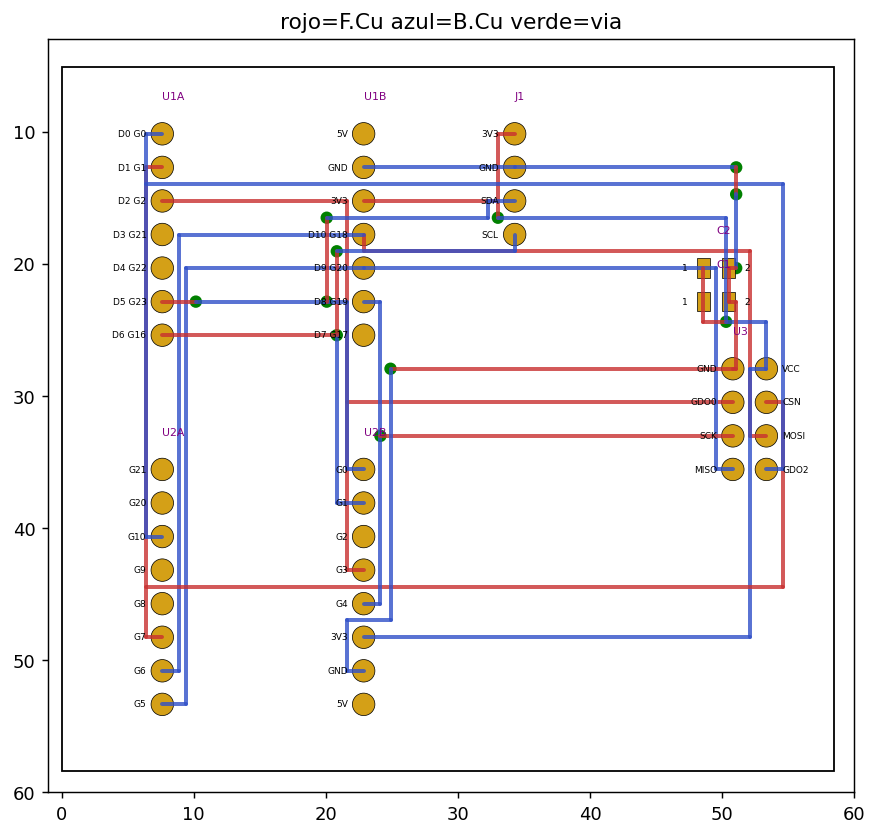
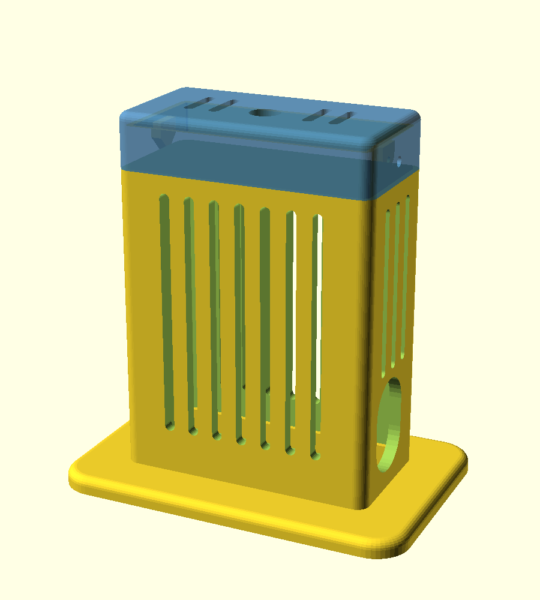
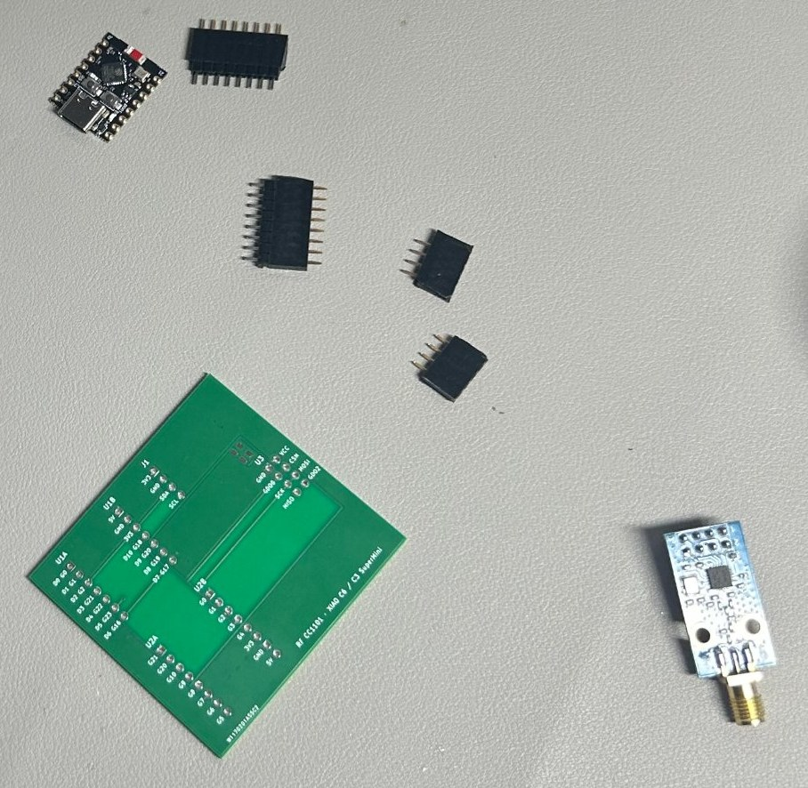
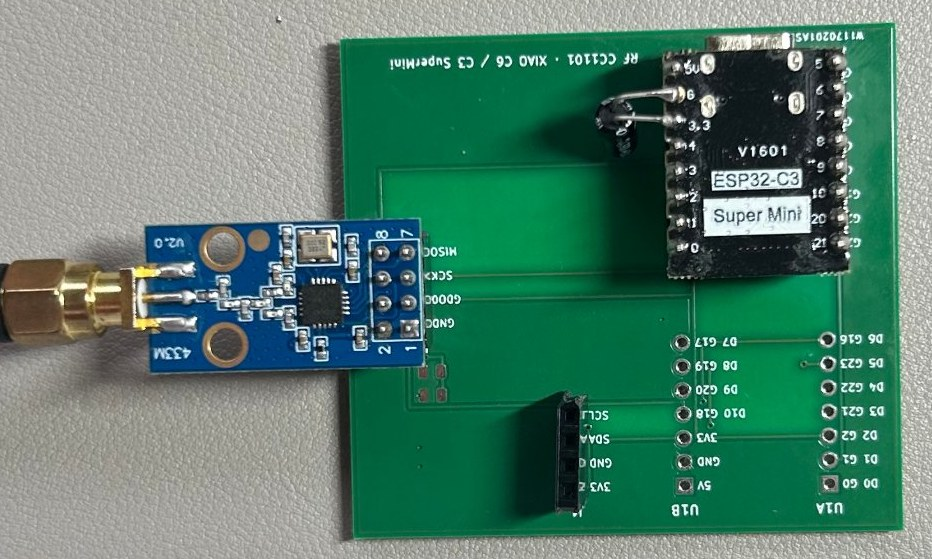
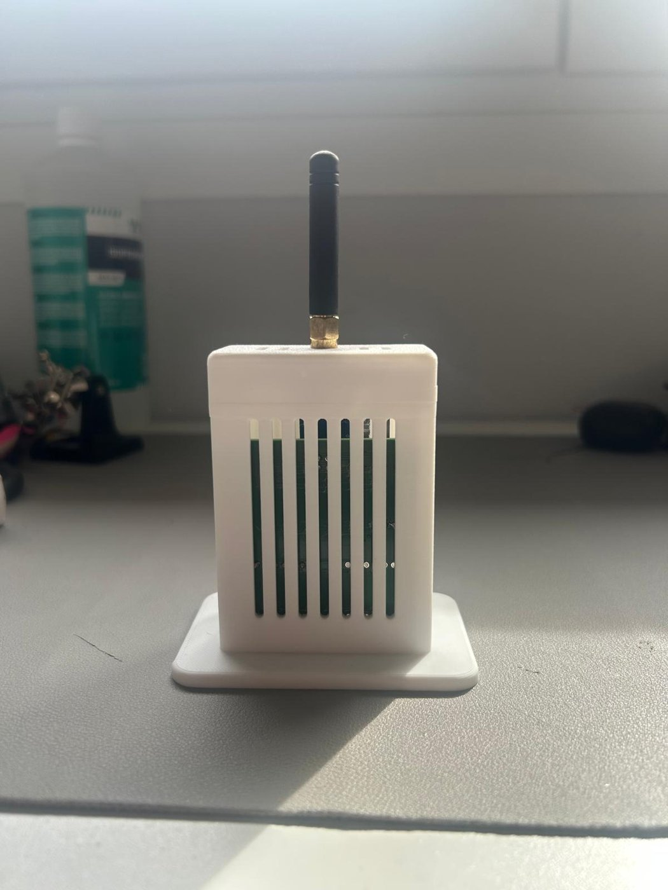
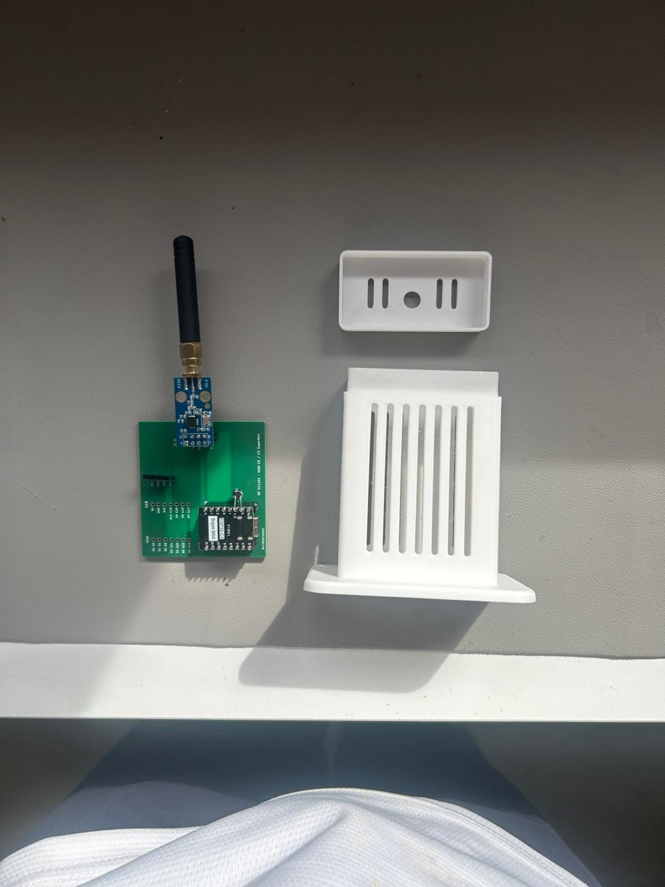

# RF CC1101 + ESP32 — placa, firmware ESPHome y caja 3D

Emisor/receptor de radiofrecuencia a **433,92 MHz** con un ESP32 y el módulo **CC1101**
(E07-M1101D), pensado para Home Assistant mediante **ESPHome**. Sirve para controlar por RF
persianas, luces, enchufes o ventiladores con mando, y para escuchar el mando original y mantener
sincronizado el estado.

El repositorio incluye todo lo necesario para reproducirlo: la **placa (PCB)** en KiCad con sus
archivos de fabricación, el **firmware** (plantilla ESPHome) y una **caja imprimible** en 3D.

<p align="center">
  
  
</p>

## Fotos

<p align="center">
  
  
</p>
<p align="center">
  
  
</p>

*Arriba: la placa tal como llega de fábrica con los zócalos, el SuperMini y el módulo antes de soldar,
y una primera prueba de encaje. Abajo: la caja impresa con la placa dentro (se ve por las ranuras) y la antena saliendo por la tapa, y las piezas antes de montar.*

## Características

- Placa de 2 capas (58,4 × 53,3 mm) con zócalos para **ESP32-C3 SuperMini** o **XIAO ESP32-C6**
  (se monta uno solo; ver estado de pruebas) y zócalo 2×4 para el módulo **E07-M1101D**.
- Cabecera I2C para un sensor de temperatura (AHT20, BME280, SHT4x…).
- Firmware con el componente nativo `cc1101` de ESPHome, emisión y recepción por un solo pin
  (GDO0) y filtros contra el ruido del receptor.
- **WiFi por portal cautivo**: no hay claves en el código; el dispositivo crea su propia red y
  eliges tu WiFi desde el móvil.
- Caja vertical con peana, tapa tipo caja de zapatos, ventilación, hueco para USB y orificio para
  la antena.

## Estructura del repositorio

```
hardware/
  pcb/
    kicad/            proyecto KiCad (.kicad_pro, .kicad_pcb, .kicad_sch)
    fabricacion/      ZIP listo para PCBWay/JLCPCB (Gerbers + taladros)
    BOM.csv           lista de materiales
    pcb_rutado.png    vista del rutado
    extras/           script Python que generó el diseño inicial (opcional)
  caja/               caja_rf_cc1101_v4.stl (caja y tapa, listo para imprimir)
firmware/
  esphome/            rf-cc1101-c3-supermini.yaml, rf-cc1101-xiao-c6.yaml y secrets.example.yaml
docs/
  capturar_codigos_rf.md   cómo capturar los códigos de un mando
  img/
```

## Hardware

### Conexiones

| Señal | XIAO ESP32-C6 | ESP32-C3 SuperMini |
|---|---|---|
| SCK | GPIO19 (D8) | GPIO4 |
| MISO | GPIO20 (D9) | GPIO5 |
| MOSI | GPIO18 (D10) | GPIO6 |
| CS (CSN) | GPIO1 (D1) | GPIO7 |
| GDO0 | GPIO2 (D2) | GPIO3 |
| GDO2 | GPIO0 (D0) | GPIO10 |
| I2C SDA | GPIO23 (D5) | GPIO0 |
| I2C SCL | GPIO16 (D6) | GPIO1 |

Orden de pines del zócalo del módulo (como el NRF24L01): 1 GND, 2 VCC, 3 GDO0, 4 CSN, 5 SCK,
6 MOSI, 7 MISO, 8 GDO2. El pin 1 lleva el pad cuadrado.

> **Nota XIAO ESP32-C6:** GPIO3 controla el conmutador de antena interno y no sale a ningún pin,
> por eso GDO2 va a GPIO0.

### Lista de materiales

- ESP32-C3 SuperMini **o** XIAO ESP32-C6.
- Módulo CC1101 **E07-M1101D** (433 MHz) con antena SMA.
- Zócalos hembra 2,54 mm: 2 × 1×8 (SuperMini) o 2 × 1×7 (XIAO) y 1 × 2×4.
- Cabecera macho 1×4 para el sensor I2C.
- Condensadores 0805: 10 µF (C1) y 100 nF (C2). Recomendable además un electrolítico de
  100 µF entre 3V3 y GND.
- 2 tornillos M2 × 4 mm autorroscantes (tapa de la caja).

### Fabricación de la PCB

1. Abre `hardware/pcb/kicad/rf_cc1101.kicad_pro` con KiCad 8 o superior.
2. Pulsa **B** para rellenar las zonas de masa y ejecuta el DRC.
3. Para pedirla, sube `hardware/pcb/fabricacion/rf_cc1101_PCBWay.zip` (9 Gerbers y el archivo de
   taladros `.txt`) a tu fabricante. Opciones: 2 capas, 1,6 mm, HASL.

Estado de las pruebas:

- **ESP32-C3 SuperMini:** probado en la PCB, funcionando en producción.
- **XIAO ESP32-C6:** probado y funcionando en producción en un prototipo **cableado a mano**.
  En esta PCB se ha verificado la continuidad de todos los GPIO entre el ESP32-C6 y el CC1101,
  pero **la PCB aún no se ha montado con el XIAO**.

## Firmware (ESPHome)

Necesita **ESPHome 2026.9 o superior**.

1. Elige el archivo de tu placa: `rf-cc1101-c3-supermini.yaml` o `rf-cc1101-xiao-c6.yaml`
   (solo cambian los pines y la placa) y cópialo a tu carpeta de ESPHome.
2. Rellena la sección `substitutions:` del principio (nombre, nombre amistoso, red y **contraseña
   del punto de acceso**). Opcionalmente genera una clave para la API. Compila y graba por USB:
   `esphome run rf-cc1101-c3-supermini.yaml`.
3. Conéctate a la red **RF-CC1101 Config** (se abre el portal; si no, entra en
   `http://192.168.33.1`), elige tu WiFi e introduce la clave.
4. Home Assistant detectará el dispositivo. Si más adelante cambia el router, la red de
   configuración reaparece sola; también puedes mantener 10 s el botón BOOT para restablecer el
   WiFi.

Decisiones de configuración que funcionan bien:

- Pin único GDO0 para emitir y recibir con `cc1101.set_idle` / `begin_tx` / `begin_rx`.
- `filter_bandwidth: 100kHz` y `filter: 150us` en el receptor contra el ruido. Si hay ruido, prueba
  `rx_attenuation`.
- `output_power: 10dBm` en el WiFi del SuperMini para mantener la conexión estable.
- Usar GDO2 como pin de recepción separado recibía bien pero no permitía emitir; se descartó.

Al final de cada YAML hay ejemplos comentados de **persiana** y **ventilador/luz** con `xxxxx` en
lugar de códigos: son los que capturas con tu mando siguiendo `docs/capturar_codigos_rf.md`
(incluye captura de códigos raw y cómo adaptar el protocolo con ayuda de Claude).

## Caja 3D

`hardware/caja/caja_rf_cc1101_v4.stl` incluye caja y tapa, listas para imprimir (158,2 × 54,6 × 83,5 mm):

- Interior útil 54 × 25 × 80 mm, con peana ancha para que no vuelque.
- Placa de pie, antena hacia arriba por la tapa (Ø7 mm) y USB lateral.
- Ventilación por ranuras, nervio y pestañas que retienen la placa.
- Tapa que abraza el labio de la caja, fijada con 2 tornillos M2 × 4 mm laterales.

## Lecciones aprendidas

1. El ruido del receptor con antena puede saturar al ESP32 y tirar el WiFi: se resuelve con los
   filtros del CC1101 y del receptor.
2. En el XIAO ESP32-C6 no se puede usar GPIO3.
3. Los tacos de los tornillos de la tapa deben sobresalir poco para que la placa entre por arriba.

## Licencia

MIT (ver `LICENSE`). Si prefieres una licencia de hardware abierto para la PCB y la caja, por
ejemplo CERN-OHL-P o CC BY-SA 4.0, cámbiala antes de publicar.
